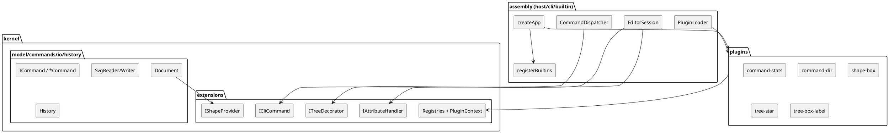

# Phase 1 → Phase 2 迭代报告

> 收尾节点（Exp-D0）。对比 tag `final`（Phase 1）与 tag `p2`（Phase 2）。

## 1. 目标回顾

| 部分 | 内容 |
|---|---|
| 第一部分 | VSCode：Explorer `.svg` 旁 `[]` 标记；原生 Outline 嵌套/定位/更新；A.3 模式分析 |
| 第二部分 | CLI 四扩展点 + `stats`/`dir`/`box`/树标签 + 双装配；内核稳定、插件可插拔 |

## 2. 架构对比

### Phase 1（tag `final`）

```plantuml
@startuml
skinparam componentStyle rectangle
package "cli" {
  [Repl]
  [CommandDispatcher]
}
package "commands" {
  [ICommand]
  [*Command]
}
package "model" {
  [Document]
  [Shape / Group]
  [ShapeFactory]
}
package "history" { [History] }
package "io" { [SvgReader] [SvgWriter] }

[Repl] --> [CommandDispatcher]
[CommandDispatcher] --> [*Command]
[CommandDispatcher] --> [Document]
[*Command] --> [Document]
[History] --> [ICommand]
[ShapeFactory] --> [Shape / Group]
@enduml
```

特征：按名分派集中在 Dispatcher + ShapeFactory；新增图形/命令需改内核装配；无插件边界。

### Phase 2（tag `p2`）



特征：内核只依赖扩展点接口；可选能力在 `plugins/`；方式 A 改组合根、方式 B 改 `plugins.config.json`；加载失败可回滚并继续启动。

## 3. 扩展点落地摘要

| 扩展点 | 插件实现 | 缺省 |
|---|---|---|
| ShapeProvider | 内置六种 + `box` | 无 box → unknown shape type |
| Command | `stats`、`dir`（适配器 `IDirectoryAccess`） | 未知命令报错 |
| TreeDecorator | `modified-star`、`(box)` | 无装饰器 tree 逐字节不变 |
| AttributeHandler | box `fill`/`label` | 回落 SetCommand |

## 4. 指标

由脚本生成：[`docs/metrics/README.md`](../docs/metrics/README.md)（LOC 分桶 + 相对 `final` 的圈复杂度启发式增量）。VSCode 扩展单独在 `vscode-svg-extension/`，不混入 CLI 增量。

## 5. 验证证据

| 项 | 证据 |
|---|---|
| VSCode 标记 / 大纲 | [`vscode-svg-extension/docs/A3_ANALYSIS.md`](../vscode-svg-extension/docs/A3_ANALYSIS.md) 截图 |
| 扩展点 / 回归 | `npm run check:f0` … `check:a0` |
| `dir` 替身 + 真实 FS | `npm run check:c1` |
| 双装配一致 | `npm run check:a0`（A/B 同会话） |
| ADR ≥ 3 | `doc/adr/0001`–`0004` |

## 6. 过程节点

VSCode V0–V2 → F0 框架 → C0/C1 命令插件 → B0/B1 box → T0 标签 → A0 双装配 → D0 文档与 tag `p2`。
