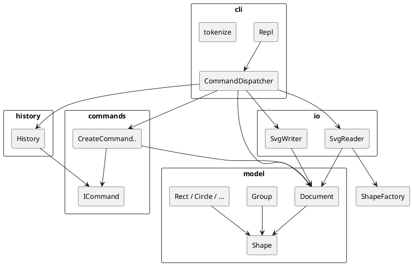

# SVG Editor（CLI）— PJ1 Phase 1 文档

> 状态：**Phase 1 完成**（Exp-0…7）；远程 tag `final`。  
> 配套约束：[AI 护栏](./AI_GUARDRAILS.md) · [实验任务边界](./TASK_BOUNDARIES.md) · 规格 [`phase_cli_1.md`](../phase_cli_1.md)

---

## 架构方案

### 1. 模块划分

| 模块（目录） | 职责 |
|---|---|
| `src/cli/` | REPL 读写、提示符、注释行跳过、命令行 tokenize、按命令名分派 |
| `src/commands/` | Command 模式：每条可编辑操作一个类（`execute` / `undo`） |
| `src/model/` | 文档与图形对象树（Composite：叶子图形 + `Group`） |
| `src/history/` | undo / redo 栈；IO 后锁定策略 |
| `src/io/` | SVG 文件读入 / 写出（与 CLI 隔离） |



**按名字分派的两处（待重构标注）：**

1. `CommandDispatcher`：命令名 → 处理逻辑  
2. `ShapeFactory`：类型名 → `Rect` / `Circle` / `Ellipse` / `Line` / `Text` / `Group`（含 `create` 与 `fromSvg`）

### 2. 设计模式的选择

| 模式 | 用途 | 落地位置 |
|---|---|---|
| **Command（必用）** | 一条编辑命令 = 一个可撤销单元 | `ICommand` + 各 `*Command`；`History.execute/undo/redo` |
| **Composite** | `move` / `scale` / `delete` 等对 `<g>` 与叶子一视同仁 | `Shape` 抽象 + `Group` 递归委托子节点 |
| **Factory（仅一处）** | `create <type>` / 读盘建对象 | `ShapeFactory`（待重构标注） |

不采用：贫血 DTO + 到处 `switch(tag)` 的过程式分派（作业范式禁止）。

### 3. 依赖方向规则

允许的依赖方向：

```text
cli  →  commands, model, history, io
commands  →  model
history  →  commands（仅 ICommand 接口）
io  →  model
model  →  （无向上依赖；不依赖 cli / io / commands / history）
```

| 规则 | 理由 |
|---|---|
| `model` 不依赖 `cli` / `io` | 领域对象与终端、文件系统解耦，便于单测与后续 GUI |
| `history` 只依赖 `ICommand` | 撤销栈不关心具体编辑细节 |
| `io` 不依赖 `commands` | 读写是文档态转换，不是用户编辑命令 |
| `cli` 可依赖各方编排 | 唯一的「组装根」；具体业务仍下沉到 commands / io |

### 4. 变化点假设

| # | 可能变化 | 预留 / 不预留 |
|---|---|---|
| 1 | 新增图形类型（如后续 `box` 插件） | Phase1 用工厂集中创建；`Shape.canUngroup()` 预留复合类型拒绝 ungroup；本阶段不实现 `box` |
| 2 | 新增 CLI 命令 | 每个命令一个 `ICommand` 类 + Dispatcher 注册一行 |
| 3 | 换 XML 解析库 | 隔离在 `io/`，`model` 不变（当前为最小手写解析） |
| 4 | 从 CLI 换 GUI / Agent 通道 | 复用 `commands` + `model` + `history`，替换 `cli` |
| 5 | undo 粒度变为「事务组」 | 可用宏命令（Composite Command）；当前按作业「一命令一单元」 |

---

## 过程记录

1. **环境**：Windows PowerShell 下 `mkdir -p` 不可用（改 `New-Item`）；nvm Node 22 npm 缺 `cache/policy.js`，改用 Node 20.19.5。  
2. **协作方式**：按 `TASK_BOUNDARIES` Exp-0…5 分步实现并分次 commit，避免一次生成全命令表。  
3. **约束文档**：`AI_GUARDRAILS.md` + `TASK_BOUNDARIES.md` + `.cursor/rules` 固化边界。  
4. **Exp-2…5**：Command 编辑 / 分组 z-order / scale·canvas / save·read；验收脚本对齐规格回显。  
5. **Exp-6（2026-10-23）**：回放 §6 与 §6.1 版本 A；逐条核对 §4.2；抽样 import；导出 `demo.svg` / `flowchart.svg` 供浏览器预览。  
   - AI/协作问题：长时间运行的旧 `npm run cli` 未加载新命令（表现为 `unknown command: group`）→ 须重启 REPL。  
   - 磁盘短暂 ENOSPC / npm 异常退出 → 清理后重试。  
   - 对照：`phase_cli_1.md` §4.2 / §6；纠正：文档与验收记录，无改规格未定义行为。  
6. **Exp-7（2026-10-23）**：定稿本文档；推送远程；打 tag `final`。

### AI 违规/纠正摘录（护栏 §6 格式）

#### 2026-10-23 Exp-3（运行时）
- AI 建议/代码问题：用户终端报 `error: unknown command: group`，易误判为实现缺失。  
- 对照规格条款：§3 `group` 已在 Exp-3 In-Scope 落地。  
- 确认方式：核对 `CommandDispatcher` 含 `case "group"`；终端为旧 REPL 进程。  
- 纠正：重启 `npm run cli`；在文档「运行方式」中写明须重启。

#### 2026-10-23 Exp-6（范围）
- AI 建议/代码问题：无一次实现版本 B / `box`。  
- 对照规格条款：§4.4 本阶段不要求；TASK_BOUNDARIES Exp-6 Out-of-Scope。  
- 确认方式：`create box` → `unknown shape type`。  
- 纠正：保持拒绝路径，仅文档记录。

---

## 一致性自查

对照架构方案如实回答：

1. **模块划分**：实际目录为 `cli` / `commands` / `model` / `history` / `io`，与方案一致；PlantUML 已补上 `cli → io`。  
2. **依赖方向**：**未违反**。抽样：`model` 无向上 import；`History` 仅 `import type { ICommand }`；`SvgReader`/`SvgWriter` 只依赖 `model`；各 `*Command` 只依赖 `model`（+ `ICommand`）；`CommandDispatcher` 作为组装根依赖各方。

| 附加检查 | 结果 |
|---|---|
| 按名字分派是否只有两处？ | 是：`CommandDispatcher` + `ShapeFactory` |
| `create box`？ | `error: unknown shape type: box (is the plugin loaded?)` |
| Composite ungroup 预留？ | `Shape.canUngroup()`；无 box 时无触发 composite 错误路径 |

---

## 质量保证手段

1. **手工回放**：对照 `phase_cli_1.md` §6 与 §6.1 版本 A（**不含**版本 B / box），命令语义与关键回显一致。  
2. **错误表对照**：§4.2 逐条造失败用例，前缀均为 `error:`。  
3. **浏览器预览**：`save` 得到的 `demo.svg` / `flowchart.svg` 可直接用浏览器或 VS Code SVG Preview 打开。  
4. **git 分步提交**：按 Exp 分次 commit，最终 tag `final`。  
5. **失败零副作用**：校验失败不入 History、不改 Document（如未知属性、非法 scale）。

### 功能完整性摘要

| 用例 | 结果 |
|---|---|
| §6 全会话 | move/undo/redo、set、group 约束、delete/undo、IO 后 undo 锁、read 缺 id 警告 |
| §6.1A 流程图 | `in` 建树、容器 move、`save flowchart.svg (8 elements)` |
| §4.2 | id / container / 类型 / ungroup / scale / 文件 IO / 未 init |

---

## 运行方式

```bash
nvm use 20.19.5   # 若刚换过 nvm 版本
npm install
npm run cli
```

改代码后须 **重启** `npm run cli`（tsx 不热更新已运行进程）。

远程仓库：`origin` → GitHub；验收以 tag `final` 为准。
