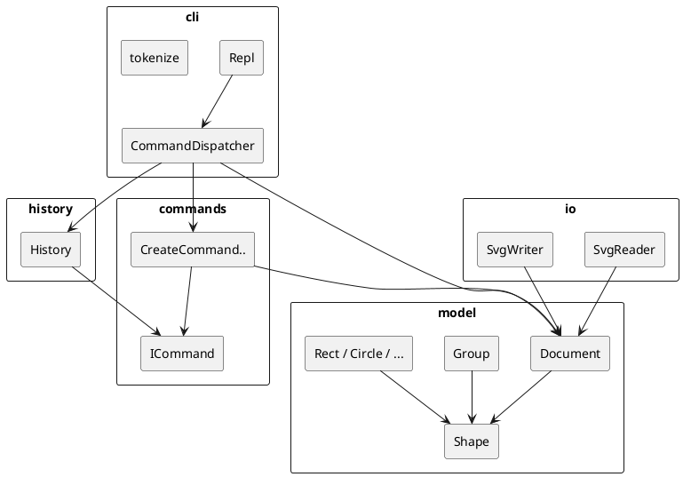

# SVG Editor（CLI）— PJ1 Phase 1 文档

> 状态：骨架阶段。本文档先锁定架构方案，后续随实现更新「过程记录 / 一致性自查 / 质量保证」。  
> 配套约束：[AI 护栏](./AI_GUARDRAILS.md) · [实验任务边界](./TASK_BOUNDARIES.md) · 规格 [`phase_cli_1.md`](../phase_cli_1.md)

---

## 架构方案

### 1. 模块划分

| 模块（目录） | 职责 |
|---|---|
| `src/cli/` | REPL 读写、提示符、注释行跳过、命令行 tokenize、按命令名分派 |
| `src/commands/` | Command 模式：每条可编辑操作一个类（`execute` / `undo`） |
| `src/model/` | 文档与图形对象树（Composite：叶子图形 + `Group`） |
| `src/history/` | undo / redo 栈；IO 后锁定策略 |
| `src/io/` | SVG 文件读入 / 写出（与 CLI 隔离） |



**按名字分派的两处（待重构标注）：**

1. `CommandDispatcher`：命令名 → 处理逻辑  
2. `ShapeFactory`：类型名 → `Rect` / `Circle` / `Ellipse` / `Line` / `Text` / `Group`  

### 2. 设计模式的选择

| 模式 | 用途 | 落地位置 |
|---|---|---|
| **Command（必用）** | 一条编辑命令 = 一个可撤销单元 | `ICommand` + 各 `*Command`；`History.execute/undo/redo` |
| **Composite** | `move` / `scale` / `delete` 等对 `<g>` 与叶子一视同仁 | `Shape` 抽象 + `Group` 递归委托子节点 |
| **Factory（仅一处）** | `create <type>` 创建对象 | 后续 `ShapeFactory`；方案中标为待重构 |

不采用：贫血 DTO + 到处 `switch(tag)` 的过程式分派（作业范式禁止）。

### 3. 依赖方向规则

允许的依赖方向：

```text
cli  →  commands, model, history
commands  →  model, (调用) history
history  →  commands（仅 ICommand 接口）
io  →  model
model  →  （无向上依赖；不依赖 cli / io / commands / history）
```

| 规则 | 理由 |
|---|---|
| `model` 不依赖 `cli` / `io` | 领域对象与终端、文件系统解耦，便于单测与后续 GUI |
| `history` 只依赖 `ICommand` | 撤销栈不关心具体编辑细节 |
| `io` 不依赖 `commands` | 读写是文档态转换，不是用户编辑命令 |
| `cli` 可依赖各方编排 | 唯一的「组装根」；具体业务仍下沉到 commands |

违反上述方向的 import 视为待处理项，实现后在「一致性自查」中抽样核对。

### 4. 变化点假设

| # | 可能变化 | 预留 / 不预留 |
|---|---|---|
| 1 | 新增图形类型（如后续 `box` 插件） | Phase1 用工厂集中创建；插件插槽留到后续阶段，本阶段不实现 `box` |
| 2 | 新增 CLI 命令 | 每个命令一个 `ICommand` 类 + Dispatcher 注册一行 |
| 3 | 换 XML 解析库 | 隔离在 `io/`，`model` 不变 |
| 4 | 从 CLI 换 GUI / Agent 通道 | 复用 `commands` + `model` + `history`，替换 `cli` |
| 5 | undo 粒度变为「事务组」 | 可用宏命令（Composite Command）；当前按作业「一命令一单元」不做过度设计 |

---

## 过程记录

（骨架阶段起笔，后续补充真实迭代。）

1. **环境**：Windows PowerShell 下 `mkdir -p src doc` 失败（应用 `New-Item`）；nvm 的 Node 22.21.1 自带 npm 损坏（缺 `cache/policy.js`），改用 Node 20.19.5 后 `npm init` 成功。  
2. **协作方式**：先定模块边界与 Command/Composite，再搭可运行 REPL（仅 `help` / `init`），避免一次生成全部命令导致无法分步 commit。  
3. **约束文档**：补充 `AI_GUARDRAILS.md` + `TASK_BOUNDARIES.md`（Exp-0…7），并用 `.cursor/rules` 固化「一次一块、禁 box、禁依赖反转、禁贫血分派」，防止后续 AI 一次生成全命令表。  
4. **待验证**：Dispatcher 内 `switch` 是否过大——若膨胀，优先抽「命令注册表」但仍保持「分派仅此一处」。

---

## 一致性自查

| 问题 | 现状（骨架） |
|---|---|
| 模块划分是否与方案一致？ | 是：`cli` / `commands` / `model` / `history` / `io` 目录已建 |
| 依赖方向是否被违反？ | 抽样：`model` 无向上 import；`History` 仅依赖 `ICommand`；`io` 仅依赖 `Document` |

实现全部命令后需再跑一遍 import 抽样。

---

## 质量保证手段

计划（随功能补齐）：

1. **手工回放**：对照 `phase_cli_1.md` 第 6 节典型会话，逐条比对输出。  
2. **错误表对照**：4.2 错误文案逐条造失败用例。  
3. **浏览器预览**：`save` 出的 `.svg` 用浏览器 / VSCode SVG Preview 打开。  
4. **git 分步提交**：每完成一类命令一次 commit，最终打 tag `final`。  
5. （可选）对 `tokenize`、`History`、Composite `move` 补单元测试。

---

## 运行方式

```bash
# 若刚换过 nvm 版本，先：
nvm use 20.19.5

npm install
npm run cli
```

当前骨架已支持：

```text
svg> help
svg> init 800 600
canvas 800x600 created
```
