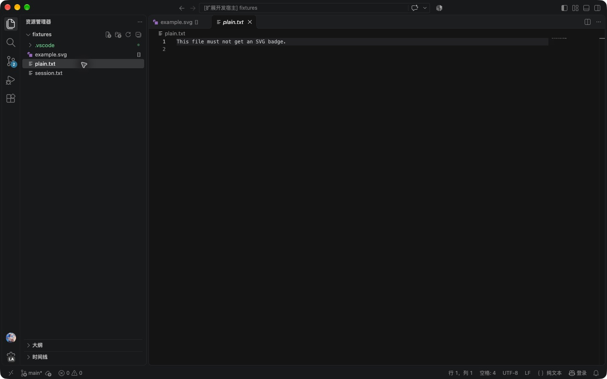
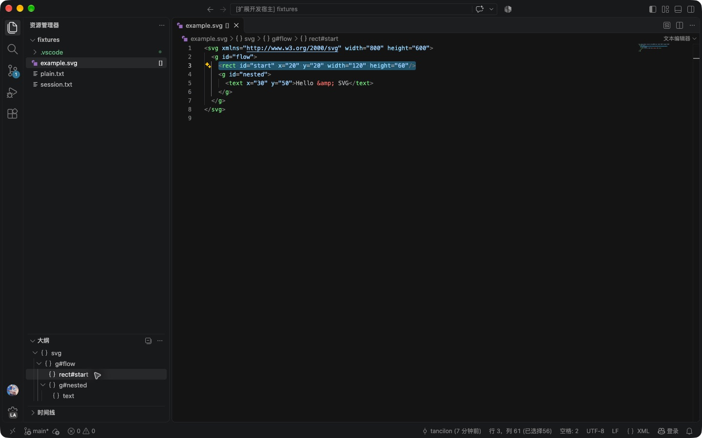

# A.3 VSCode 扩展：分析与演示（Exp-V2）

> 对应规格 `phase_cli_2.md` §A.3。  
> 扩展源码：`vscode-svg-extension/`。安装步骤见 [../README.md](../README.md)。

---

## 1. 演示证据

### 1.1 安装 / 启动（摘要）

```bash
cd vscode-svg-extension
pnpm install
pnpm run compile
# F5 → Run SVG Extension；Host 打开 fixtures
pnpm run check:v0
pnpm run check:v1
```

### 1.2 示例 SVG

- [`../fixtures/example.svg`](../fixtures/example.svg) — 嵌套 `g#flow` / `rect#start` / 无 id 的 `text`
- [`../fixtures/broken.svg`](../fixtures/broken.svg) — 残缺 XML（大纲不崩溃）
- [`../fixtures/plain.txt`](../fixtures/plain.txt) — 对照：无 `[]` 标记

### 1.3 截图

| 效果 | 截图 | 说明 |
|---|---|---|
| Explorer `.svg` 旁 `[]` |  | 仅 SVG 有标记；`plain.txt` / 目录无标记；文件名不变 |
| Outline 层级与定位 |  | 选中 `rect#start` 定位到源码；无 id 显示为 `text` |

> 截图展示与本扩展 fixtures 一致的运行效果。本地可用 F5 复现后替换为自行截取的图片。

---

## 2. VSCode 与插件的职责及调用过程

### 2.1 职责划分

| 角色 | 职责 |
|---|---|
| **VSCode（宿主）** | 提供扩展宿主、Explorer / Outline UI、文档生命周期、扩展 API（注册表与回调） |
| **本插件** | 实现「何时装饰」「如何从 SVG 文本抽出符号树」；**不**自绘 Explorer/大纲控件 |

插件**不拥有**界面；只向宿主登记能力，由宿主在适当时机回调。

### 2.2 注册 → 回调过程

```text
activate(context)
  ├─ registerFileDecorationProvider(SvgFileDecorationProvider)
  └─ registerDocumentSymbolProvider(selector, SvgDocumentSymbolProvider)

Explorer 刷新某 URI
  └─ VSCode → provideFileDecoration(uri)
        └─ 若 .svg → FileDecoration("[]")；否则 undefined

打开/编辑 .svg，Outline 需要符号
  └─ VSCode → provideDocumentSymbols(document)
        └─ parseSvgOutline(text) → DocumentSymbol 树
        └─ 用户点击符号 → VSCode 按 selectionRange/range 跳转
```

要点：

1. **插件主动注册，宿主主动调用**（IoC）：插件不轮询 UI。
2. **选择器**（`**/*.svg` / `xml` / `svg`）决定哪些文档触发大纲回调。
3. **编辑更新**：文档变更后宿主再次调用 `provideDocumentSymbols`；插件无缓存状态亦可正确刷新。
4. **残缺 XML**：解析器吞掉异常并返回 `[]` 或部分树，避免扩展进程崩溃。

相关代码：`src/extension.ts`、`SvgFileDecorationProvider.ts`、`SvgDocumentSymbolProvider.ts`、`SvgOutlineParser.ts`。

---

## 3. 文件装饰与 Decorator / Adaptor 模式

### 3.1 本扩展中的对象关系

```text
VSCode Explorer 渲染管线
    │  调用
    ▼
FileDecorationProvider（接口，宿主定义）
    ▲  实现
SvgFileDecorationProvider（本插件）
    │  返回
    ▼
FileDecoration("[]")  —— 附加在「文件条目展示」上的徽章信息
```

装饰对象**不包装**另一个 `File` 业务对象去改变其读写行为；URI 指向的文件内容始终不变。

### 3.2 与经典 Decorator 的对应与差异

| 维度 | 经典 GoF Decorator | 本扩展的 File Decoration |
|---|---|---|
| 意图 | 动态为对象叠加职责，且保持同一接口 | 为资源**展示**叠加徽章/颜色/tooltip |
| 结构 | `Component` ← `Decorator` 包装 `concrete` | 宿主持有 URI；插件按 URI **附加**元数据 |
| 透明性 | 客户端常通过同一接口使用包装后对象 | Explorer 仍打开原文件；装饰可有可无 |
| 组合 | 多层 Decorator 可嵌套 | 多个 `FileDecorationProvider` 可由宿主合并结果 |
| 差异 | 改变的是**对象行为/能力**的装配 | 改变的是**UI 呈现**，不改变文件系统对象 |

**结论**：概念上都是「不改核心对象定义而附加能力」，但 File Decoration 是**宿主提供的装饰钩子（UI 元数据）**，不是在插件内用包装类改写 `TextDocument` 接口。更接近「展示层装饰」，而非领域对象上的 GoF Decorator 链。

### 3.3 与 Adaptor 的对应与差异

| 维度 | 经典 Adaptor | 本扩展相关部分 |
|---|---|---|
| 意图 | 把已有接口转换成客户期望的接口 | `SvgOutlineParser` 的树 → `DocumentSymbol` |
| 结构 | `Target` ← `Adapter` → `Adaptee` | `DocumentSymbolProvider`（Target）← Provider → `OutlineNode` 树（Adaptee） |
| 文件装饰 | 通常不涉及「接口转换」 | `FileDecorationProvider` 本身已是宿主 Target；实现类直接满足，**无需**再包一层 Adaptor |
| 大纲 | — | `SvgDocumentSymbolProvider` 承担 **Adaptor**：把内部 `OutlineNode` 适配成 VSCode 的 `DocumentSymbol` |

**结论**：

- **文件标记**：主要是 Provider 回调 + UI 装饰，**不宜强行说成 Adaptor**；与 Decorator 是「意图相近、结构不同」。
- **大纲**：`SvgDocumentSymbolProvider` 明确扮演 Adaptor（内部解析模型 → 宿主符号模型）。

---

## 4. Phase 1 代码复用评估

Phase 1 CLI 相关模块：`src/io/SvgReader.ts`、`src/model/*`、树输出（`Shape.toTreeLine` 等）。

| 模块 | 能否复用到本 VSCode 扩展 | 原因 |
|---|---|---|
| `SvgReader` / 内部 `parseSvg` | **难以直接复用** | 面向「构建 `Document` + 领域 Shape」；缺 id 会补全并 `warning`；忽略非白名单标签；依赖 Node `fs` 与 model。Outline 需要**源码偏移**做定位，Reader 不保留 offset。 |
| `Shape` / `Group` / 叶子类 | **不适合** | 封装的是编辑语义（move/set/scale/undo），不是编辑器符号；引入会把 CLI 领域模型拖进扩展，耦合过重。 |
| `Shape.toTreeLine` / CLI `tree` | **不可直接复用** | 输出的是 CLI 文本树，不是 `DocumentSymbol`；且依赖已构建的对象树而非文本文档。 |
| 「栈式扫标签」思路 | **可借鉴（已独立实现）** | `SvgOutlineParser` 与 Reader 同属轻量 XML 扫描，但目标不同：保留 offset、容忍残缺、不建领域对象。 |
| `Tokenizer` / Command 层 | **无关** | 扩展不执行 CLI 命令。 |

### 4.1 可复用 vs 应隔离

- **可复用的是「知识」**：SVG/XML 标签层级、`id` 显示约定、容器标签集合。
- **不应复用的是「制品」**：Phase 1 的 Document/Shape 图与 IO 错误语义；两边生命周期不同（CLI 会话 vs 编辑器文档）。
- **推荐边界**：扩展侧保持 `SvgOutlineParser` 纯函数 + Provider；若未来要统一，可抽 **共享的「带偏移 XML 事件流」** 到独立包，再分别适配为 Shape 树与 DocumentSymbol——当前阶段独立实现更符合低耦合。

---

## 5. 验收核对（Exp-V2）

- [x] 扩展源码可运行（`pnpm run compile` / `check:v0` / `check:v1`）
- [x] 安装启动步骤（README + 本文 §1.1）
- [x] 示例 SVG（fixtures）
- [x] 截图：标记 + 大纲定位（`docs/images/`）
- [x] VSCode ↔ 插件职责与注册回调（§2）
- [x] Decorator / Adaptor 对应与差异（§3）
- [x] Phase 1 复用评估（§4）
